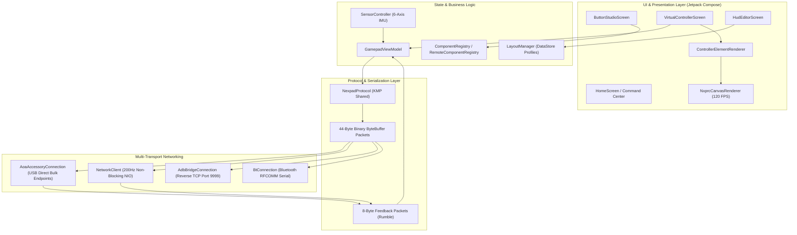

# 🏛️ NEXPAD Android Architecture

Deep technical design, runtime pipelines, and component models of the **NEXPAD Android** client application.

```
                    ┌───────────────┐
                    │   README.md   │
                    │ "What is it?" │
                    └───────┬───────┘
                            │
            ┌───────────────┴───────────────┐
            ▼                               ▼
       HISTORY.md                    ARCHITECTURE.md
       "Where we                         "How it
       came from"                         works"
```

---

## 🏗️ High-Level System Architecture



---

## ⚡ Multi-Transport Subsystem

NEXPAD supports 4 interchangeable transport engines governed by `IGamepadConnection`:

### 1. Android Open Accessory (AOA 2.0) - USB Direct
* **Protocol**: Leverages `android.hardware.usb.UsbManager` to claim accessory mode (`VID 0x18D1, PID 0x2D00 / 0x2D01`).
* **Endpoints**: Obtains raw `ParcelFileDescriptor` file streams with dedicated real-time background TX and RX threads.
* **Performance**: Sub-millisecond ($< 1\,\text{ms}$) hardware transmission with zero network packet loss and zero Wi-Fi interference.
* **Driverless**: Requires no developer mode, no ADB configuration, and no root permissions.

### 2. High-Speed UDP Client (200Hz Non-Blocking)
* **Pipeline**: Non-blocking `DatagramSocket` executing on a dedicated pinned `Dispatchers.IO` coroutine thread.
* **Rate**: Emits 44-byte binary datagrams (`PACKET_TYPE_INPUT = 0x01`) at sustained **200 Hz** ($5\,\text{ms}$ ticks) with microsecond timestamping.
* **Feedback**: Receives 8-byte rumble feedback packets (`PACKET_TYPE_FEEDBACK = 0x02`) asynchronously to actuate phone vibration motors.

### 3. ADB Reverse TCP Bridge
* **Routing**: Connects to `127.0.0.1:9999` (and fallback `127.0.0.1:9997`) routed via `adb reverse tcp:9999 tcp:9999`.
* **Reliability**: Provides a dependable wired backup connection over standard Android Debug Bridge.

### 4. Bluetooth RFCOMM Serial
* **Protocol**: Standard RFCOMM socket paired directly with host PC's Bluetooth stack.
* **Optimization**: Includes bufferbloat mitigation, burst coalescing, and one-way input latency tracking.

---

## 🎨 Procedural Vector & NXPRC Animation Engine

All button and stick rendering is 100% procedural—zero raster bitmaps are used in gameplay:

### 1. 7-Layer Canonical Rendering Stack
Every control is rendered mathematically using Jetpack Compose `Canvas` and `DrawScope` across 7 deterministic layers:
1. **Layer 0: Kinetic Aura** (`.drawBehind`) — Atmospheric neon bloom expanding with interaction depth.
2. **Layer 1: Recessed Bezel** — Concave structural well with ambient shadow occlusion.
3. **Layer 2: Beveled Body Rim** — Micro-chamfered perimeter rim stroke.
4. **Layer 3: Dynamic State Plane** — Spring-interpolated Z-axis physical depression.
5. **Layer 4: Procedural Graphic Core** — Concentric machining grooves, liquid fill meniscus, or radar sweeps.
6. **Layer 5: Typography / Symbol** — High-contrast vector labels with back-face depth.
7. **Layer 6: Specular Optical Sheen** — Micro-lens reflections and glass glare arcs.

### 2. Universal Timeline Track Engine
* Dynamic piecewise-linear keyframe timeline track system interpolating multi-property animations at up to **120 FPS**:
  - **Transform Tracks**: Scale, translation, rotation, and skew.
  - **Color & Glow Tracks**: Linear and conic RGB color transitions, alpha fading, and variable-radius shadow blur.
  - **Physical Feedback Tracks**: Real-time thumbstick 2D deflection vector offsets, trigger depression travel, and rumble jitter actuation.

---

## 🕹️ 6-Axis Motion & Gyroscope Steering

The `SensorController` accesses Android's physical IMU hardware (`TYPE_ACCELEROMETER`, `TYPE_GYROSCOPE`, and `TYPE_ROTATION_VECTOR`):
* **Steering Wheel Mode**: Computes real-time tilt angle $\theta = \arctan2(a_y, a_x)$ normalized to Xbox 360 left stick horizontal axis $[-32768, 32767]$.
* **CemuHook DSU Protocol**: Generates standard Cemuhook motion packets over UDP port `26760`, enabling native motion aiming in console emulators (Cemu, Yuzu, Ryujinx, Dolphin, RPCS3).
